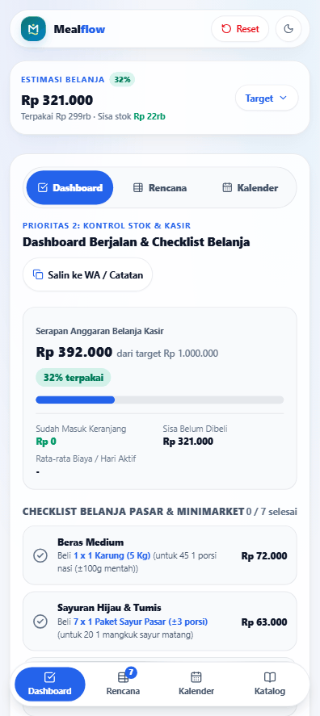
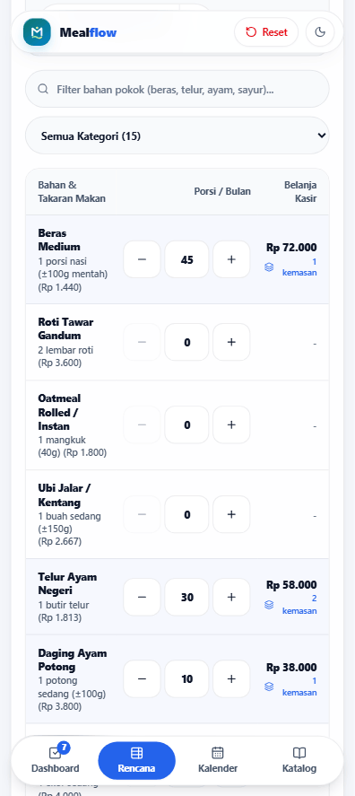
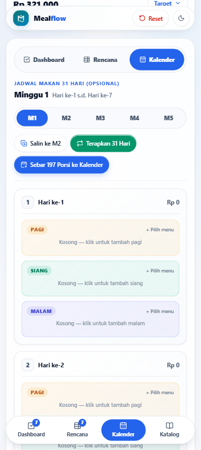
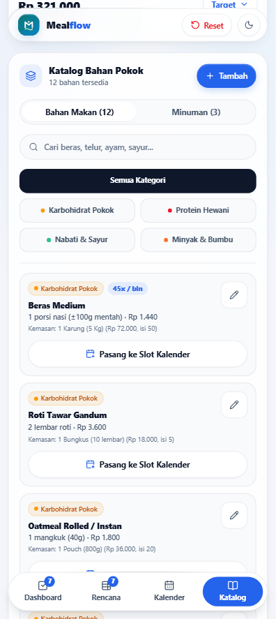

<p align="center">
  
</p>

<h1 align="center">Mealflow</h1>

<p align="center">
  <strong>Monthly Staple Grocery Budgeting, Retail-Pack Rounding & Optional 31-Day Meal Scheduling</strong>
</p>

<p align="center">
  <a href="./LICENSE"></a>
  
  
  
  
</p>

---

## App Preview

<div align="center">
  <table>
    <tr>
      <td align="center" valign="top">
        <a href="./docs/screenshots/mobile-dashboard.png">
          
        </a>
        <br />
        <sub><strong>Dashboard & Cashier</strong></sub>
      </td>
      <td align="center" valign="top">
        <a href="./docs/screenshots/mobile-planner.png">
          
        </a>
        <br />
        <sub><strong>Monthly Planner (Rencana)</strong></sub>
      </td>
      <td align="center" valign="top">
        <a href="./docs/screenshots/mobile-calendar.png">
          
        </a>
        <br />
        <sub><strong>31-Day Calendar (Kalender)</strong></sub>
      </td>
      <td align="center" valign="top">
        <a href="./docs/screenshots/mobile-catalog.png">
          
        </a>
        <br />
        <sub><strong>Staple Catalog (Katalog)</strong></sub>
      </td>
    </tr>
  </table>
</div>

> **screenshots Assets (`./docs/screenshots/`):** Place your mobile viewport captures at `./docs/screenshots/mobile-dashboard.png`, `./docs/screenshots/mobile-planner.png`, `./docs/screenshots/mobile-calendar.png`, and `./docs/screenshots/mobile-catalog.png`.

---

## Table of Contents

- [Overview & Domain Model](#overview--domain-model)
- [Core Features & UX Guardrails](#core-features--ux-guardrails)
- [Tech Stack & Tooling](#tech-stack--tooling)
- [System Architecture](#system-architecture)
- [Project Structure](#project-structure)
- [Getting Started](#getting-started)
- [Verification & Troubleshooting](#verification--troubleshooting)
- [Contributing & License](#contributing--license)

---

## Overview & Domain Model

Monthly food budgets frequently drift because **consumption portions** differ from **retail market packaging**. Users consume portions such as 1 bowl of rice, 1 egg, 1 chicken cut, or 1 tbsp of cooking oil, whereas retail purchases are quantized into whole packs (such as 5 kg rice, 1 kg eggs, or 1 water gallon).

Mealflow follows a **Consumption-First Input, Retail-Pack Output** model tailored for Indonesian households and boarding-house residents (*anak kos*):

1. **Monthly Primary Budgeting**: Aggregate expected consumption portions per staple item across a 31-day cycle against a configurable monthly budget target (`targetBudget`).
2. **Packaging & Inventory Control**: Round up consumed portions to whole retail packs (`Math.ceil(usedPortions / portionsPerPack)`), compute retail checkout cost vs. consumed value, surface remaining stock value, flag low-utilization packs (`< 50%`), and run **Smart Pantry Auto-Suggest** for cooking oil and basic seasonings proportional to raw cooking sessions.
3. **Optional 31-Day Scheduling (`M1`–`M5`)**: Keep daily meal slot scheduling (`Pagi`, `Siang`, `Malam`) optional and bi-directionally synced with monthly frequency counts rather than forcing users to fill all 31 days just to estimate a grocery budget.

---

## Core Features & UX Guardrails

- **Curated Staple Catalog & Custom Overrides**: Organized into core food and home-brew drink categories (`src/data/default-catalog.ts`, `src/data/catalog-items.json`). Supports custom items, local price/pack overrides, and reset to defaults without leaving the client.
- **Monthly Frequency Planner & Editable Meal Bundles**: Adjust monthly portions via `+/-` steppers or numeric input, use starter templates (*Pola Hemat Anak Kos* and *Pola Dapur Harian*), and apply editable meal bundles that decompose into raw staple portions.
- **Interactive 31-Day Calendar & Slot Picker**: Supports `Sebar Porsi ke Kalender`, desktop drag-and-drop, mobile tap-to-place (`pendingItem`), week copying (`Salin ke M{n+1}`), 31-day pattern duplication (`Terapkan 31 Hari`), and direct slot selection via `SlotMenuPickerModal` (`onOpenSlotPicker`).
- **Destructive & Overwrite Confirmation Guardrails**: Actions that overwrite existing plans or clear state—such as applying starter templates (`InteractiveEmptyState`), duplicating a week across 31 days, clearing a day, or resetting the workspace—trigger `ConfirmDialog` (`role="alertdialog"`) to prevent accidental taps on mobile viewports.
- **Dashboard-First Entry & Cashier Checklist**: Opens on the **Dashboard** view (`grocery` / `dashboard`) with budget absorption progress, category breakdown, cashier checklist (`checkedItemIds`), WhatsApp/plain-text grocery export, optional average daily nutrition estimates, and JSON backup/restore (`storage-engine.ts`).
- **Theme Transitions & Offline PWA**: Light/dark mode with View Transitions API support (`use-theme.ts`), `localStorage` persistence (`mealflow.workspace.v3`), Web App Manifest (`public/manifest.webmanifest`), and Service Worker (`public/sw.js`).

---

## Tech Stack & Tooling

| Layer | Technology | Role & Engineering Notes |
| :--- | :--- | :--- |
| **UI Framework** | React 19 + TypeScript | Declarative components with strict mode and `verbatimModuleSyntax` |
| **Build & Dev Server** | Vite | Fast HMR, production bundling, and local preview server |
| **Styling** | Tailwind CSS v4 | CSS-first styling, semantic design tokens (`tokens.css`), and bento layouts (`components.css`) |
| **Icons** | Lucide React | Vector UI icons |
| **Offline & PWA** | Web App Manifest + Service Worker | Static asset caching and offline support (`public/sw.js`, `public/manifest.webmanifest`) |
| **Static Analysis** | TypeScript (`tsc --noEmit`) & Oxlint | Type safety and static lint checks |

---

## System Architecture

Mealflow runs **100% client-side (Local-First, Zero-Backend)** with deterministic arithmetic in domain utilities and debounced persistence to `window.localStorage`:

```text
+-----------------------------------------------------------------------+
|                         PRESENTATION LAYER                            |
|  FloatingNavbar       BudgetTargetCard       FloatingGuideWidget      |
|  CatalogPanel         MonthlyFrequencyPlanner (Templates & Bundles)   |
|  OngoingDashboardView WeeklyCalendarGrid (SlotMenuPickerModal)        |
|  GrocerySummaryPanel  MobileBottomNav        ConfirmDialog            |
+-----------------------------------+-----------------------------------+
                                    |
                                    v
+-----------------------------------------------------------------------+
|                      STATE & PERSISTENCE LAYER                        |
|  useMealflowStore (Bi-Directional Sync, Memoized Budget & Catalog)    |
|  storage-engine.ts (localStorage v3, 250ms Debounce, JSON Backup/IO)  |
+-----------------------------------+-----------------------------------+
                                    |
                                    v
+-----------------------------------------------------------------------+
|                         CORE DOMAIN ENGINE                            |
|  budget-engine.ts --------> Portion Aggregation, Retail Pack Rounding,|
|                             Leftover Stock (<50% Flag), Smart Pantry  |
|  export-and-nutrition.ts -> Plain-Text Grocery List & 31-Day Macros  |
|  format.ts --------------> IDR (`Rp`) Formatting & Compact Labels      |
+-----------------------------------------------------------------------+
```

---

## Project Structure

```text
mealflow/
├── docs/
│   └── screenshots/
│       ├── mobile-calendar.png
│       ├── mobile-catalog.png
│       ├── mobile-dashboard.png
│       └── mobile-planner.png
├── public/
│   ├── favicon.svg
│   ├── manifest.webmanifest
│   └── sw.js
├── src/
│   ├── components/
│   │   ├── brand/
│   │   ├── calendar/
│   │   │   ├── MealSlotCard.tsx
│   │   │   ├── SlotMenuPickerModal.tsx
│   │   │   └── WeeklyCalendarGrid.tsx
│   │   ├── catalog/
│   │   ├── dashboard/
│   │   ├── layout/
│   │   ├── planner/
│   │   │   ├── InteractiveEmptyState.tsx
│   │   │   ├── MealBundleModal.tsx
│   │   │   └── MonthlyFrequencyPlanner.tsx
│   │   ├── summary/
│   │   └── ui/
│   │       └── ConfirmDialog.tsx
│   ├── data/
│   │   ├── catalog-items.json
│   │   └── default-catalog.ts
│   ├── hooks/
│   │   ├── use-debounced-value.ts
│   │   ├── use-mealflow-store.ts
│   │   └── use-theme.ts
│   ├── services/
│   │   └── storage-engine.ts
│   ├── styles/
│   │   ├── components.css
│   │   ├── index.css
│   │   └── tokens.css
│   ├── types/
│   │   └── meal.ts
│   ├── utils/
│   │   ├── budget-engine.ts
│   │   ├── export-and-nutrition.ts
│   │   └── format.ts
│   ├── App.tsx
│   └── main.tsx
├── index.html
├── package.json
├── tsconfig.json
└── vite.config.ts
```

---

## Getting Started

### Prerequisites

- **Node.js**: Active/Maintenance LTS release (check `package.json` `engines` or install Node.js 20+/22+ LTS).
- **Package Manager**: `npm` (or `pnpm` / `yarn` compatible with `package.json` scripts).

### Installation & Local Development

1. **Clone and enter the repository**

   ```bash
   git clone <repository-url>
   cd mealflow
   ```

2. **Install dependencies**

   ```bash
   npm install
   ```

3. **Start the development server**

   ```bash
   npm run dev
   ```

4. **Type-check and build for production**

   ```bash
   npx tsc --noEmit && npm run build
   ```

5. **Preview the production bundle locally**

   ```bash
   npm run preview
   ```

---

## Verification & Troubleshooting

- **Type & Build Check**: Run `npx tsc --noEmit && npm run build` before opening a pull request or tagging a release.
- **Stale LocalStorage State (`mealflow.workspace.v3`)**: If a previous session stored an older tab or schema state in `localStorage`, use the top-bar **Reset** action (confirmed via `ConfirmDialog`) or clear `mealflow.workspace.v3` in browser DevTools -> Application -> Local Storage.
- **No Secrets or Environment Variables**: Because Mealflow runs entirely client-side with zero backend secrets, no `.env` file is required for local development.

---

## Contributing & License

- **Contributing**: Open an issue or pull request with clear reproduction steps, affected component paths, and verification results (`tsc --noEmit` and `npm run build`). Follow Conventional Commits (for example: `feat:`, `fix:`, `docs:`, `refactor:`).
- **License**: Distributed under the **MIT License**. See [LICENSE](./LICENSE) for details.